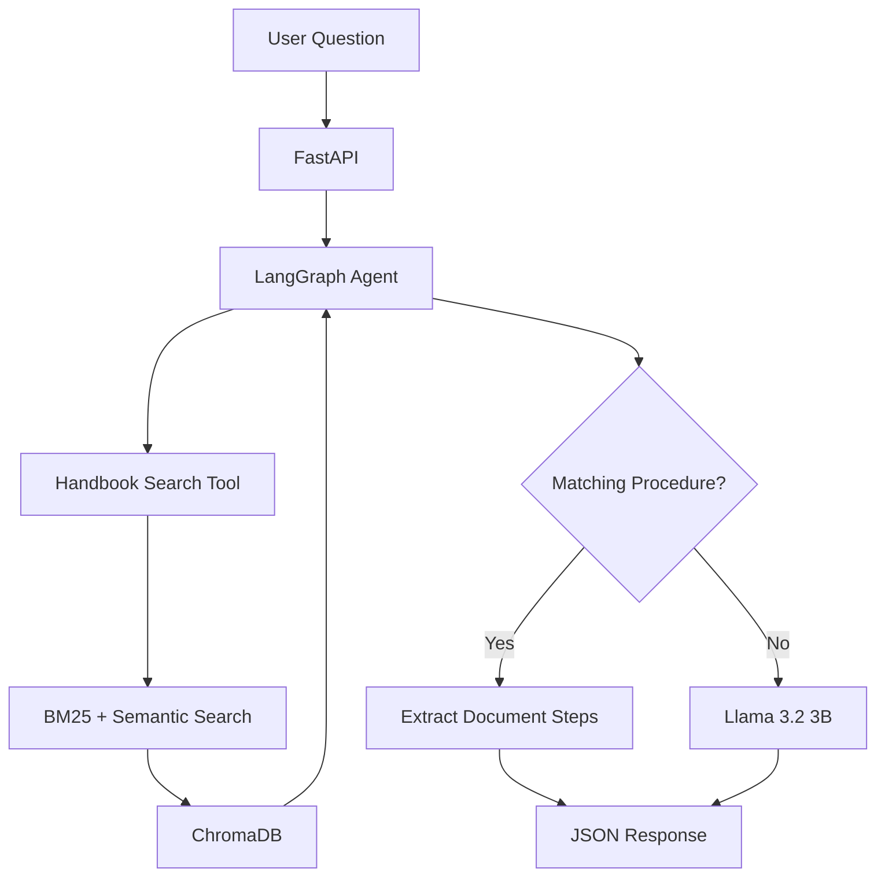

# Agentic RAG Knowledge Assistant

A locally hosted AI knowledge assistant that answers questions using the GitLab Communication Handbook.

Built with Python, LangGraph, hybrid retrieval, ChromaDB, Llama 3.2 3B, FastAPI, and Docker.

## Project Overview

This project explores how organizations can use Retrieval-Augmented Generation (RAG) to answer questions from company documentation.

Instead of relying only on an LLM's general knowledge, the assistant retrieves relevant handbook sections and uses them to answer employee questions.

## Key Features

- Downloads and processes GitLab Communication Handbook content
- Preserves document headings through section-aware chunking
- Creates embeddings using all-MiniLM-L6-v2
- Stores document chunks in ChromaDB
- Combines BM25 keyword search and semantic retrieval
- Uses LangGraph to coordinate LLM tool calling
- Uses locally hosted Llama 3.2 3B through Ollama
- Extracts exact steps for matching documented procedures
- Declines questions when the retrieved evidence is insufficient
- Exposes a POST /ask endpoint using FastAPI
- Supports containerized execution through Docker Compose

## Architecture



## Technologies

| Component | Technology |
|---|---|
| Programming | Python |
| Agent orchestration | LangGraph |
| LLM | Llama 3.2 3B |
| Local model hosting | Ollama |
| Embeddings | all-MiniLM-L6-v2 |
| Vector database | ChromaDB |
| Keyword retrieval | BM25 |
| API | FastAPI |
| Request validation | Pydantic |
| Containerization | Docker Compose |

## Data Source

GitLab Communication Handbook:

https://handbook.gitlab.com/handbook/communication/

The initial experiment produced 193 section-aware chunks. The count may change if the source document changes.

## Local Setup (Windows PowerShell)

### 1. Clone the repository

```powershell
git clone https://github.com/Afreen8200/agentic-rag-knowledge-assistant.git
cd agentic-rag-knowledge-assistant
```

### 2. Create a virtual environment

```powershell
python -m venv .venv
.\.venv\Scripts\Activate.ps1
```

### 3. Install Python dependencies

```powershell
python -m pip install -r requirements.txt
```

### 4. Install and prepare Ollama

Install Ollama from https://ollama.com/

Download the model:

```powershell
ollama pull llama3.2:3b
```

Make sure Ollama is running.

### 5. Build the knowledge base

```powershell
python build_section_knowledge_base.py
```

This downloads the handbook, creates section-aware chunks and embeddings, and stores them in:

`data/chroma_sections/`

The vector database is generated locally and is not committed to GitHub.

### 6. Run the agent

```powershell
python langgraph_section_agent.py
```

### 7. Run FastAPI

```powershell
python -m uvicorn api:app --host 127.0.0.1 --port 8000
```

Open:

http://127.0.0.1:8000/docs

## Docker Setup

Prerequisites:

- Docker Desktop running
- Ollama running on Windows
- Llama 3.2 3B downloaded
- Knowledge base generated using the setup above

Build and start the application:

```powershell
docker compose up -d --build
```

View container status:

```powershell
docker compose ps
```

View logs:

```powershell
docker compose logs --tail=50
```

Open the API documentation:

http://127.0.0.1:8000/docs

Stop the application:

```powershell
docker compose down
```

Docker runs FastAPI and LangGraph. Ollama remains on the Windows host and is accessed using `host.docker.internal`.

## API Example

Endpoint:

`POST /ask`

Request:

```json
{
  "question": "What should employees do if Slack is down?"
}
```

Example response structure:

```json
{
  "question": "What should employees do if Slack is down?",
  "answer": "Follow the Slack Down! emergency chat procedure on Zoom.",
  "tool_executions": 1
}
```

The response above illustrates the API format; actual answers depend on retrieved evidence.

## Evaluation

The initial evaluation tests four questions:

1. Slack outage procedures
2. Zoom outage procedures
3. Asynchronous communication
4. An unsupported vacation-policy question

The evaluation checks retrieval, required answer details, known procedural errors, and unsupported-question handling.

These tests are preliminary and do not establish production-level reliability.

## Limitations

- The knowledge base currently uses one public handbook page.
- The extractive guardrail works best with clearly formatted procedures.
- Retrieval may return unrelated content for unsupported questions.
- The local API does not yet include production authentication, rate limiting, or comprehensive monitoring.
- Ollama and ChromaDB data must be available separately from the Docker image.

## Future Improvements

- Expanded automated evaluations
- Improved relevance and faithfulness checks
- FastAPI error handling and automated tests
- Model latency and resource usage tracking
- Optional chat interface

## Project Status

Working local prototype with FastAPI, LangGraph, ChromaDB, Ollama, and Docker Compose.
```
